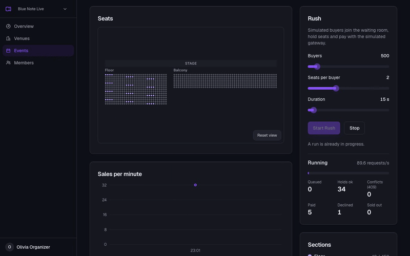
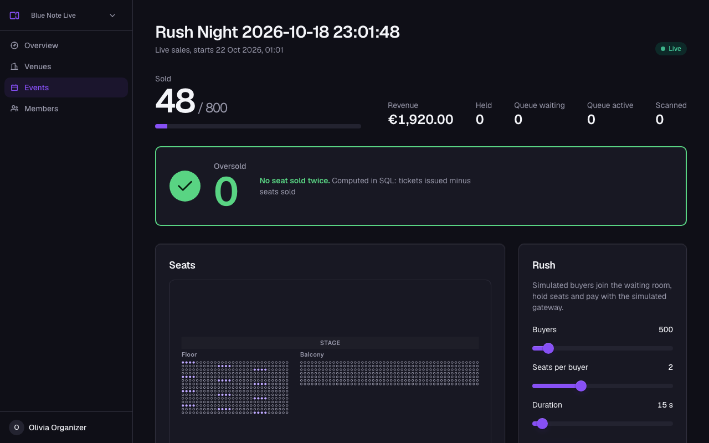
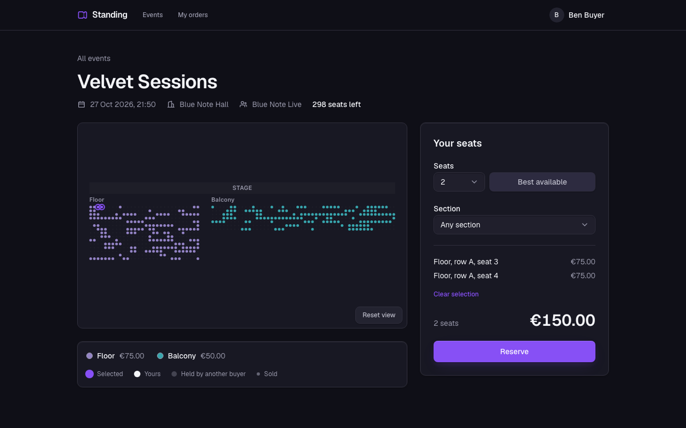
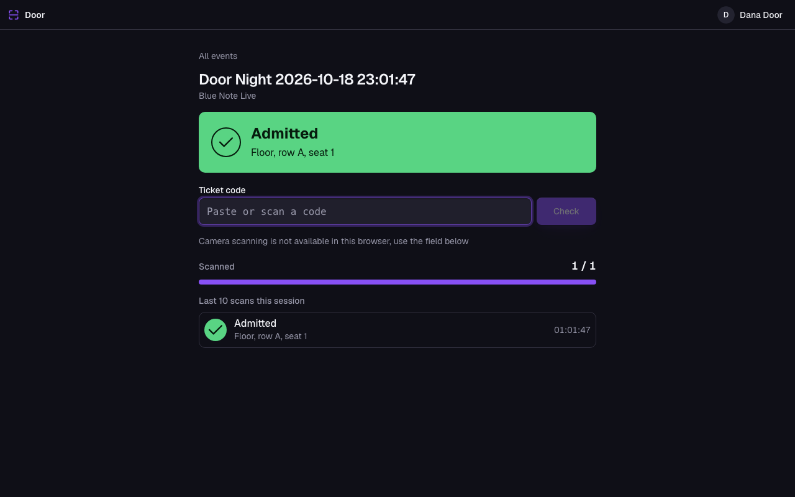
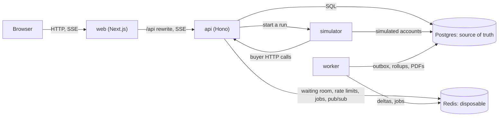

# Standing

**Multi-tenant ticketing where a Rush of 5,000 simulated buyers cannot oversell a seat, and the dashboard proves it with an independent SQL check.**

Organizers publish events on a seat map, buyers hold and pay for seats (simulated payment), door staff scan signed tickets, and a **Start Rush** button sends simulated buyers at the real API while the live dashboard shows sales and `Oversold: 0`. It is a portfolio project: local only, fictional data, no real payment.



| Live dashboard: sold, revenue, Oversold | Storefront seat map | Door scan page |
| --- | --- | --- |
|  |  |  |

The GIF and screenshots were recorded by `npm run media` against a freshly created event ("Rush Night ..."), not the seeded *Aurora Night*.

## Try it in 60 seconds

Needs Docker (with Compose v2) and free local ports 5441, 6380, 4100 and 3200.

```bash
git clone <repository-url> standing && cd standing
docker compose -p standing up --build
```

1. Open <http://localhost:3200>.
2. Click **Sign in**, then the **Organizer** demo button.
3. Open the **Aurora Night** event (Blue Note Live).
4. Press **Start Rush**.

The first build takes a few minutes. The api container runs the migrations and the demo seed on start.

**A Rush can sell out the event.** *Aurora Night* starts about half sold (800 seats), so one or two Rushes with the default settings can sell it out, after which another Rush has nothing to buy. To replay: create another event from the same venue in the console (**Events**, new event on *Blue Note Hall*, set prices, publish) and run the Rush there, or start over with a fresh seed:

```bash
docker compose -p standing down -v && docker compose -p standing up --build
```

The three one-click demo buttons exist only because the web image is built with the `NEXT_PUBLIC_DEMO_LOGIN=1` build argument, which `docker-compose.yml` sets. It is read at build time, not at run time.

### What to look at

- **Oversold** on the live dashboard: computed in SQL on every tick as tickets issued minus seats sold, plus seats that appear in more than one order line. It is never counted by the simulator. A non-zero value would mean the database constraints failed.
- **The waiting room**: each event admits `admission_limit` buyers at a time (default 200) and queues the rest in arrival order; the Rush panel counts the simulated buyers that had to queue (*Queued*), and the dashboard shows *Queue waiting* and *Queue active*.
- **Exports**: CSV and XLSX of sales, streamed from a Postgres cursor; a PDF report rendered by the worker.
- **The door page**: sign in as **Door staff**, pick an event, and enter a ticket code. Codes are inside the ticket QR codes (the buyer's *My orders* page) and in the `code` field of `GET /api/orders/<orderId>`. A second scan says *Already scanned* with the first scan time; a ticket of another event says *Wrong event*.

## Architecture



- Postgres decides every seat, order and ticket; Redis only holds things that may be lost (waiting room, rate limits, the PDF job queue, live deltas), and each fails open or is rebuilt from Postgres.
- A hold claims seats with `FOR UPDATE SKIP LOCKED` (never waits, all or nothing, lazy expiry); a payment turns the hold into an order, tickets and an outbox row in one transaction.
- The worker projects the outbox into rollups exactly once and publishes best-effort deltas; the dashboard combines Postgres snapshots, one-second Postgres ticks and deltas over SSE.
- A single middleware is the authorization point for every tenant route, and a matrix test fails when a route escapes it.

Details, diagrams (components, data model, purchase sequence) and the reasoning are in [docs/ARCHITECTURE.md](docs/ARCHITECTURE.md) and the ADRs:
[0001 Postgres is the source of truth](docs/adr/0001-postgres-is-the-source-of-truth.md) ·
[0002 Waiting room fails open](docs/adr/0002-waiting-room-fails-open.md) ·
[0003 Outbox and exactly-once rollups](docs/adr/0003-outbox-and-exactly-once-rollups.md) ·
[0004 Materialized seat inventory](docs/adr/0004-materialized-seat-inventory.md) ·
[0005 No row-level security in v1](docs/adr/0005-no-row-level-security-in-v1.md) ·
[0006 SKIP LOCKED holds](docs/adr/0006-skip-locked-holds.md)

## Guarantees and the tests that prove them

All tests run against real Postgres and Redis (`npm test`). Each line says what the test proves, no more.

| Guarantee | Proven by |
| --- | --- |
| **No seat is sold twice.** 200 buyers racing for 50 seats give exactly one winner per seat; overlapping requests never leave a partial hold; the race stays exact after every first hold expired | `apps/api/src/services/holds.test.ts` |
| A seat reclaimed after expiry is sold only to its new holder; the old holder gets 410 | `apps/api/src/services/payments.test.ts` |
| The database itself refuses a second sale of a seat (unique index) and incoherent seat states (two CHECK constraints) | `packages/db/src/schema.test.ts` |
| A full simulated Rush (300 buyers on 50 seats) ends with `oversold = 0` and paid buyers equal to orders | `apps/simulator/src/run.test.ts` |
| A Rush with a Redis flush in the middle (seats still free at the flush, orders keep growing after it, buyers re-join the queue), and a Rush with Redis erroring for the whole run, both end with `oversold = 0`, orders equal to paid buyers, rollups equal to a raw recompute | `apps/simulator/src/rush.integration.test.ts` (see the known weakness below) |
| A Rush started from the UI on a fresh event ends with `Oversold` showing 0, and the event's CSV export holds that event's sales only | `e2e/organizer-rush.spec.ts` |
| **Payment is idempotent.** The same Idempotency-Key, even in parallel, creates one order; two different keys in parallel pay once; a decline is stored and a retry under a new key works; a closed or started event refuses payment (409) | `apps/api/src/services/payments.test.ts` |
| **One scan wins.** 20 simultaneous scans of the same ticket admit it once; forged codes are rejected before any database access; a ticket of another event is refused | `apps/api/src/services/scan.test.ts`, `e2e/door.spec.ts` |
| **No deadlock on one hold.** Cancel or pay racing a replacing hold of the same buyer, and the expired-hold cleanup racing cancels and replacements, never deadlock (one lock order: hold row, then seats; the cleanup skips locked rows) | `apps/api/src/services/lock-order.test.ts` |
| **Rollups are exactly-once.** Rollups equal a raw recompute; a second run changes nothing; 500 outbox rows with two concurrent projectors are each projected once; two projectors over events in opposite orders never deadlock | `apps/worker/src/projector.test.ts` |
| **Redis is disposable.** The waiting room fails open on Redis errors and re-queues buyers after a flush (it fails closed for a buyer until they re-join); rate limits reset; no seat decision reads Redis; a ticket PDF whose job Redis lost is re-queued by the sweeper; the live stream keeps ticking from Postgres | `apps/simulator/src/rush.integration.test.ts`, `apps/worker/src/documents/sweeper.test.ts`, `apps/worker/src/documents/queue.integration.test.ts`, `apps/api/src/services/waiting-room.test.ts`, `apps/api/src/redis-rate-limit.test.ts`, `apps/api/src/routes/live.test.ts` |
| **Tenant isolation.** Every tenant route × anonymous × each role × a member of another tenant: 401, 404 for outsiders (never 403), 403 for too-low roles; another tenant's event or venue id through the caller's own tenant URL is 404 and changes nothing; the test fails if a registered route is missing from the matrix | `apps/api/src/authz.matrix.test.ts` |
| **Exports keep memory flat.** 200,000 CSV rows stream with heap growth under 80 MB; no other tenant's rows | `apps/api/src/services/exports.test.ts`, `apps/api/src/routes/exports.test.ts` |

**What the Redis-flush test proves, and what it does not.** It flushes Redis 1.5 seconds into an 8-second Rush of 3,000 buyers on a 900-seat event. It asserts that seats were still free at the flush (held + sold below 900; observed 368 to 406), that orders kept growing after it (observed 65 to 77 at the flush, 510 to 540 at the end), that buyers re-joined the waiting room (`requeued > 0`; observed 219 to 241), and the end state (no oversell, orders equal paid buyers, rollups equal a raw recompute, held + sold >= 810). It does **not** prove arrival order or fairness after the flush (both are reset), and each run is one timing. The fail-open test (Redis erroring on every call) runs with `noDocumentQueue`, so it does not exercise the PDF queue.

## Benchmark

From [docs/bench/latest.md](docs/bench/latest.md) (`npm run bench`: 5,000 simulated buyers over 60 s on a fresh 4,800-seat event, up to 2 seats each, no abandonment):

| Metric | Value |
| --- | --- |
| Machine | Apple M1 Max, 10 cores, 32 GiB |
| Duration | 60.4 s |
| HTTP requests | 19,195 (318 per second) |
| Holds ok / conflicts | 3,398 / 314 |
| Orders paid | 3,390 |
| Seats sold (database) | 4,788 of 4,800 |
| Hold latency p50 / p95 | 9 ms / 16 ms |
| Pay latency p50 / p95 | 160 ms / 167 ms |
| Oversold | 0 |

Caveat, from the file: these numbers describe one laptop running the load generator, the API, the worker, Postgres, Redis and the web app together. They are not a capacity claim for a real deployment. Also: pay latency is mostly the simulated gateway's configured 150 ms delay, not real work, and "holds" counts hold requests, not buyers (late buyers find the venue full and leave without one). The notes in the file explain both.

## Limitations, stated plainly

- **Simulated payment only.** The gateway is a configurable sleep (150 ms) and a random decline (5%). No card data exists anywhere.
- **One-laptop benchmark.** See above.
- **The Rush simulator is not a distributed load test.** It is one Node process on the same machine as everything else, making the same calls as a browser. It inserts its simulated buyer accounts straight into Postgres.
- **False conflicts.** Holds use `SKIP LOCKED`, so two overlapping multi-seat requests can both get a 409 although the seats end up free; clients retry ([ADR 0006](docs/adr/0006-skip-locked-holds.md)). The storefront then greys those seats out until the page is reloaded.
- **SSE fan-out is in-process per API instance.** Each API instance relays Redis pub/sub to its own SSE clients; there is no other shared bus and no sticky-session handling. Next's gzip is off (`compress: false`) because it buffered the SSE stream behind the `/api` rewrite; a production setup needs compression at a reverse proxy with proxy buffering disabled for `/api/**/live`.
- **Single Postgres.** No replica, no failover.
- **No refunds.** The live view's rule that revenue and sold figures never go down relies on it.
- **Camera scanning depends on `BarcodeDetector`**, which not every browser has; manual code entry is the fallback. The real camera path was not tested (the e2e suite is headless).
- **Tenant isolation has no database backstop.** No row-level security in v1 ([ADR 0005](docs/adr/0005-no-row-level-security-in-v1.md)); the middleware and the matrix test are the guarantee.
- **Waiting-room release is best effort**: the web app releases the slot on page hide and unmount (keepalive request), but a crashed browser or a lost connection keeps it until it expires (5 minutes). Browsing the event page consumes a slot while the page is open, for signed-in visitors only (anonymous visitors take no slot).
- **Admission tickets are bearer tokens**, not bound to the user (anti-bot is out of scope, [ADR 0002](docs/adr/0002-waiting-room-fails-open.md)).
- **Login rate limit bypass, locally.** The compose API runs with `TRUST_PROXY=1` and is published on 127.0.0.1, so a direct local caller can rotate `X-Forwarded-For` and bypass the login limiter. Local demo only.
- **Child tables carry no `tenant_id`.** The root aggregates (venues, events, orders, documents, outbox) do; `order_items`, `tickets`, `event_seats` and the other children inherit the tenant through foreign keys.
- **Plain-string ids in most service signatures.** Branded id types are used in `packages/shared`, `packages/core` and some services only.
- **Exports**: an export that fails after the 200 headers were sent yields a truncated file. A day range needs both `from` and `to` (at most 366 days).
- **Gateway ordering.** The simulated gateway decides before the hold is validated; a real integration needs authorize, commit, then capture ([ADR 0001](docs/adr/0001-postgres-is-the-source-of-truth.md)).
- **PDFs show amounts without a currency symbol.**
- **Node images run as root** (local demo only).
- **UI review.** The web UI was built with the Pulse design system and checked in a real browser (Playwright at 390 and 1440 px: no horizontal scroll, 44 px touch targets on mobile, visible focus, contrast ratios computed from the rendered styles; numbers in the task reports). The Better Design MCP review gates (review rules, comprehension check, spacing inspection, dashboard review receipt) were **not** run for the web screens because the tool's free quota was exhausted. The UI has not been validated by that tool.
- **Icons.** MingCute line icons, selected by the Pulse design system; the menu icon (`menu-line`) was redrawn by hand in the same style until the exact glyph is installed.
- **Generated UI kit.** `apps/web/src/components/ui` holds 278 generated shadcn/Pulse files, about 270 of them unused. The folder is excluded from ESLint and from the TypeScript roots (the files the app imports are still type-checked). One local patch in `dropdown-menu.tsx` is marked at the top of the file; `shadcn add -o` would revert it.
- **CI has never been observed green on GitHub.** The workflow in `.github/workflows/ci.yml` exists, but the GitHub account was billing-locked when this was written, so it has not run. On 2026-10-19 the same steps passed locally: `npm run lint`, `npm run typecheck`, `npm test` (72 test files, 520 tests) and `npm run e2e` (5 tests, twice in a row, against the compose stack).

## Tech stack

TypeScript 6 (strict, branded ids, Zod-inferred types) on Node 22 · Hono 4 · Drizzle ORM 0.45 with SQL migrations · PostgreSQL 17 · Redis 7 with ioredis 6 · BullMQ 6 · pdfkit and qrcode · exceljs streaming writer and pg-query-stream · Next.js 16 (App Router), React 19, TanStack Query 5, Tailwind CSS 4, shadcn/ui on Base UI with the Pulse design system, MingCute icons, Recharts · Vitest 5 · Playwright 1.64 · Docker Compose.

## Repository layout

```
apps/api         Hono API: auth, tenants, venues, events, storefront, holds, payment, door, exports, live SSE, Rush control
apps/worker      outbox projector, expired-hold cleanup, materialized view refresh, PDF rendering (BullMQ), document sweeper
apps/simulator   virtual buyers (Rush) and the benchmark
apps/web         Next.js: storefront, organizer console, live dashboard, door page
packages/db      Drizzle schema, migrations, test database helpers
packages/shared  Zod schemas, branded ids, Clock, constants
packages/core    Redis helpers, channels, ticket signing, outbox payloads
e2e              Playwright end-to-end tests (run against the compose stack)
scripts          record-media.ts (README screenshots and GIF)
docker           Dockerfiles for the node services and the web app
docs             ARCHITECTURE.md, adr/, bench/, media/
```

## Demo accounts

**Local use only.** The compose stack seeds fictional data, ships a known password, enables one-click demo logins and insecure cookies, and binds every port to 127.0.0.1. Never expose it to a network.

- One-click buttons on the sign-in page: **Organizer**, **Buyer**, **Door staff**.
- Email and password, if you prefer the form (password `standing-demo-1` for all three):
  - `organizer@demo.standing.local`
  - `buyer@demo.standing.local`
  - `door@demo.standing.local`

## Running the tests

With the compose stack running (the tests use its Postgres on `localhost:5441` and Redis database 15 on `localhost:6380`; each test creates and drops its own databases):

```bash
npm ci
npm run lint
npm run typecheck
npm test
npx playwright install chromium   # once
npm run e2e                       # against http://127.0.0.1:3200
npm run bench                     # rewrites docs/bench/latest.md
```

The full command reference is in [docs/ARCHITECTURE.md](docs/ARCHITECTURE.md#commands).
